# Time Rings

**A circular, Apple-Watch-style view of time, built as one HTML file that doubles as a Chrome new-tab page.**

Seconds, minutes, hours, day of week, day of month, month and your age (0–100) are drawn as concentric rings that fill as time passes. Each ring is colored by what it means, and every part can be toggled, reordered and customized. Everything runs in your browser. There is no server, no build step and no tracking.

**[▶ Try it live in your browser](https://amintaheri23.github.io/time-rings/)**

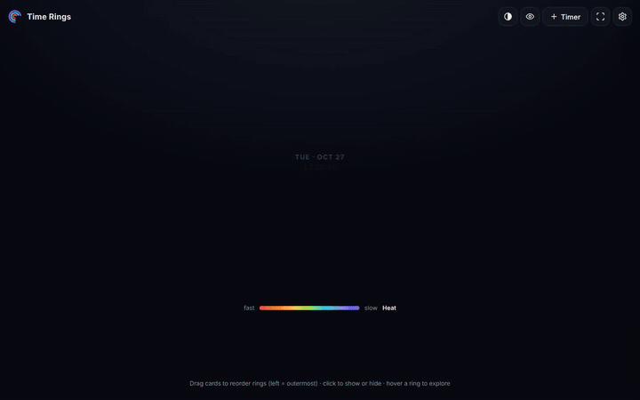

[Watch the full-quality video, with music](docs/demo.mp4)

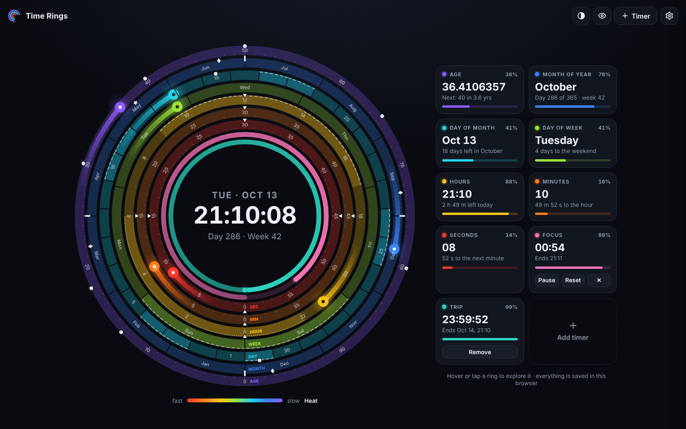

## Contents

- [Quick start](#quick-start)
- [Features](#features)
- [Install as a Chrome new-tab extension](#install-as-a-chrome-new-tab-extension)
- [Using it](#using-it)
- [Rings](#rings)
- [Meaning colors](#meaning-colors)
- [The age ring](#the-age-ring)
- [Markers](#markers)
- [Custom rings](#custom-rings)
- [Timers](#timers)
- [Daily briefing](#daily-briefing)
- [Bookmarks](#bookmarks)
- [Themes and accessibility](#themes-and-accessibility)
- [Settings reference](#settings-reference)
- [Privacy](#privacy)
- [How it works](#how-it-works)
- [Project layout](#project-layout)
- [Development](#development)
- [Known limitations](#known-limitations)
- [Inspiration](#inspiration)
- [License](#license)

## Quick start

1. Download [`index.html`](index.html).
2. Open it in any modern browser.

That is all. Your settings are saved in the browser (`localStorage`). To use it as your new-tab page with bookmarks, follow the [extension steps](#install-as-a-chrome-new-tab-extension).

## Features

| Area | What you get |
| --- | --- |
| **Rings** | Seconds, minutes, hours, day of week, day of month, month of year, age (0–100). Slowest ring outside, zero point at the bottom, 24-hour hours (12-hour optional). |
| **Click to show/hide** | Click any card under the dial to turn its ring on or off. |
| **Drag to reorder** | Drag cards to change the ring order. Cards stay in one horizontal row. Keyboard: `Alt` + `←`/`→`. Touch: long-press, then drag. |
| **Meaning colors** | Weekends in red, hours shaded by sunrise and sunset for your time zone, months by season, age by life stage. Each has custom color pickers. |
| **Age ring** | Enter your birthdate. Milestones and typical-American life data (driving, voting, marriage, first child, retirement…) are marked on the ring. |
| **Markers** | Midnight/noon, sunrise/sunset, work hours, night, weekends, mid-month, solstices and equinoxes, quarters, your birthday and more, each individually toggled. |
| **Custom rings** | Your own rings: a time window every day (start and end time, or start and duration, on the weekdays you pick) or once between two dates. Saved with a card in the bottom bar. |
| **Timers** | Colored countdown timers, each drawn as its own ring. When one finishes, it chimes several times and the page slowly breathes in the timer's color until you click. |
| **Disc timer** | Show a timer as a filled disc in the center of the dial that empties as time runs out, like a kitchen Time Timer. Pick it in the timer dialog or with the pie icon on the timer's card. |
| **Pop-out** | Float a timer or custom ring in a small always-on-top window over your other apps, like picture-in-picture video, with pause and reset buttons. |
| **Daily briefing** | On the first new tab of the day, the rings are shown one by one with a short caption timed to your reading speed. Skippable. |
| **Bookmarks** | Chrome bookmarks bar, folders and most-visited sites on the new tab (extension version). |
| **Looks** | Light, dark or auto theme. Heat, light-spectrum and viridis palettes. A color-blind-safe (Okabe–Ito) mode. Smooth animation, hover highlight. |
| **Presets** | Default, Minimal, Clock, Life and Everything. |
| **Hide seconds digits** | Keep the seconds ring but remove the ticking numbers from the whole page. |
| **Minimal display** | Show only the rings and the clock: the header, bookmarks, legend and cards go, the dial grows, and the ring labels and markers are dropped. A second step, **Rings only**, hides the clock too. Step through Off → Rings + clock → Rings only with the corner icon, the `M` key or settings. |

## Install as a Chrome new-tab extension

The [`extension/`](extension) folder is a ready-to-load Manifest V3 extension.

1. Open `chrome://extensions`.
2. Turn on **Developer mode** (top right).
3. Click **Load unpacked** and choose the `extension/` folder.
4. Open a new tab.

To update later, replace the folder's contents and press the reload icon on the extension's card.

Permissions requested, and why:

| Permission | Used for |
| --- | --- |
| `bookmarks` | Showing your bookmarks bar and folders. |
| `topSites` | The "Most visited" shortcuts option. |
| `favicon` | Site icons next to bookmarks, loaded locally by Chrome. |

No network access and no host permissions are requested. The standalone `index.html` works fine without any of these, but it cannot read bookmarks (browsers do not allow web pages to do that).

### Publishing to the Chrome Web Store

1. Build the zip: `python tools/build_ext.py index.html .` (creates `time-rings-newtab.zip`).
2. Register a [Chrome Web Store developer account](https://chrome.google.com/webstore/devconsole) (one-time fee).
3. Upload the zip, add a description, at least one 1280×800 screenshot (see [`docs/screenshots`](docs/screenshots)) and a privacy statement. The statement can say that all data stays on the device.
4. Justify each permission using the table above, then submit for review.

Other Chromium browsers (Edge, Brave) should be able to load the same folder, though only Chrome has been tested. Firefox would need a different manifest.

## Using it

- **Hover or tap a ring** to highlight it. Its value appears in the center and the other rings dim.
- **Click a card** to show or hide that ring. The dot on the card is also a keyboard-accessible toggle.
- **Drag a card** to reorder the rings.
- **Gear icon** opens settings: birthdate, presets, palette, markers, meaning colors, briefing, shortcuts.
- **Half-circle icon** switches theme. **Eye icon** toggles color-blind-friendly colors.
- **Corner-brackets icon** (or the `M` key) steps through the minimal display: **Rings + clock**, then **Rings only** (no clock; hover a ring to see its value), then back to off. In minimal mode only a faint icon and gear stay in the top-right corner. Cards are hidden then, so timers can't be paused or removed until you switch it off. Ring names stay visible if color-blind mode is on.
- **+ Timer** adds a timer (duration or until a clock time, with a label and a color). Choose **Show as: Disc** to draw it as a filled disc in the center; the pie icon on a timer's card switches it between ring and disc later.
- **Pop-out icon** (the small screen on a timer's or custom ring's card) floats it in a picture-in-picture window. Click it again, or close the window, to bring it back.
- **Add ring** (the last card under the dial, or Settings → Rings → **＋ Custom ring**) adds a [custom ring](#custom-rings).

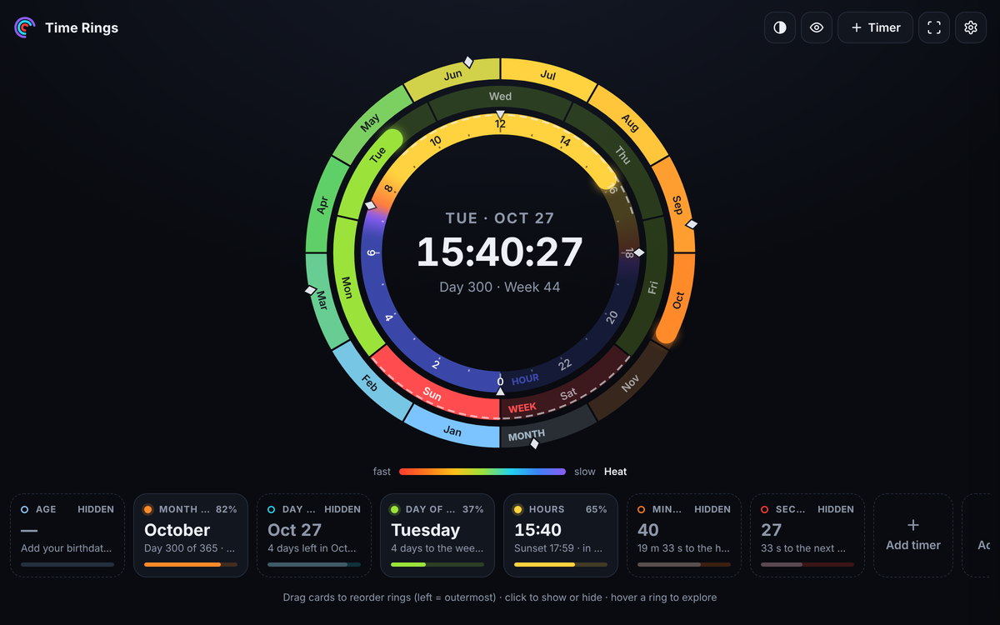

New users start with only **Day of week**, **Hours** and **Month** on. Everything else is one click away.

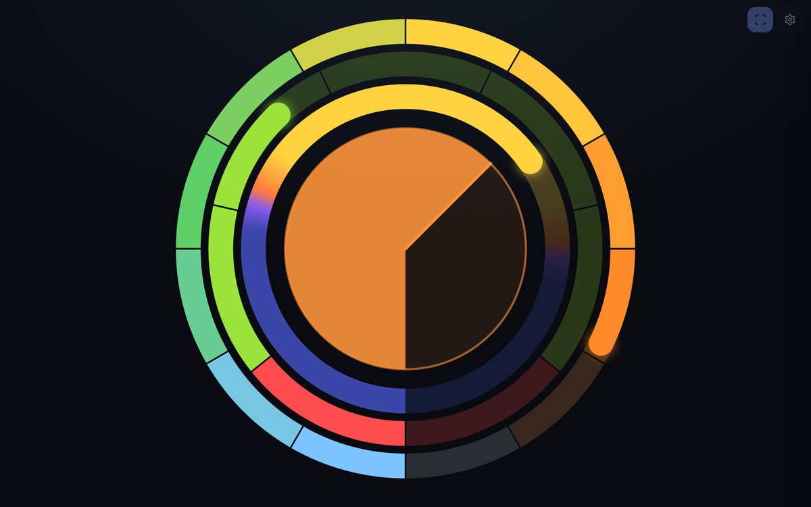

The **Rings only** minimal display: no clock, no cards, just the rings and a disc timer in the middle.

## Rings

| Ring | Fills over | Notes |
| --- | --- | --- |
| Seconds | 1 minute | Digits can be hidden globally. |
| Minutes | 1 hour | |
| Hours | 24 hours | Shaded by daylight; 12-hour display optional. |
| Day of week | 7 days | Week can start on Sunday or Monday. Weekends are marked. |
| Day of month | 28–31 days | Mid-month and last-day markers. |
| Month | 12 months | Seasons and solstice/equinox markers. |
| Age | 0–100 years | Needs a birthdate. Shows milestones and life data. |

Ring order is "slowest outside" by default. Drag cards to arrange it however you like, and the order is saved.

## Meaning colors

Instead of coloring a ring by speed, color it by what each part means. Each type has its own on/off switch and custom color pickers.

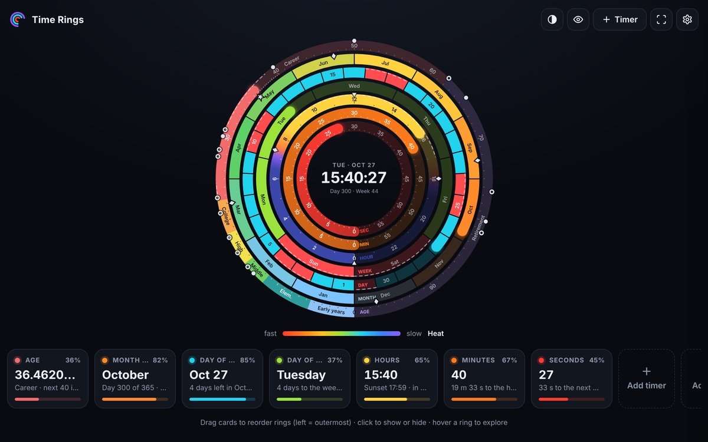

- **Day of week:** weekend days are red.
- **Hours:** the ring is shaded by night, dawn, day and dusk. Sunrise and sunset are computed with the NOAA solar equation from your location. The location comes from your time zone (a built-in table of zone to latitude/longitude), or you can set your own. Computed times were checked against timeanddate.com and agree within about a minute. Polar day and polar night are handled.
- **Month:** colored by season, with the winter, spring, summer and autumn colors adjustable.
- **Age:** colored by life stage (childhood, school, career, retirement…).

## The age ring

Enter your birthdate in settings. The ring then shows your exact age with decimals, the percentage of 100 years, and the next milestone.

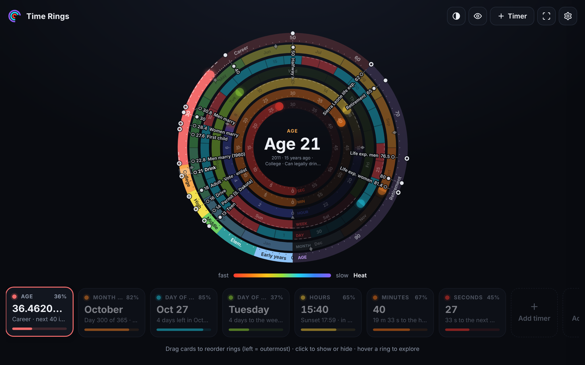

- **Your milestones:** a comma-separated list such as `13 Teen, 18 Adult, 30, 40, 50 Halfway, 65 Retirement`.
- **Typical life data (US):** spokes and labels derived from the "Life of a Typical American" chart (for example driving, voting, marriage, first child, retirement age), with figures updated to current US data. These are averages, not predictions.

## Markers

Every marker can be switched on or off in settings, and the choice is saved.

| Marker | Where it appears |
| --- | --- |
| Quarter marks :15 :30 :45 | Seconds and minutes rings |
| Midnight and noon | Hours ring |
| Sunrise and sunset | Hours ring |
| Work hours 9–17 | Hours ring (dashed band) |
| Night 22–06 | Hours ring (dotted band) |
| Weekends | Week and day rings (dashed band) |
| Mid-month and last day | Day of month ring |
| Solstices and equinoxes | Month ring |
| Quarters Q1–Q4 | Month ring |
| Birthday | Month and day rings |
| Your life milestones | Age ring |
| Typical life data (US) | Age ring |

Shapes and dash patterns differ per marker, so they stay distinguishable in color-blind mode.

## Custom rings

Add rings for your own time windows. Each is saved in the browser and keeps a card in the bottom bar, where **Edit** and **Remove** live. Like the other rings, it can be shown, hidden and dragged.

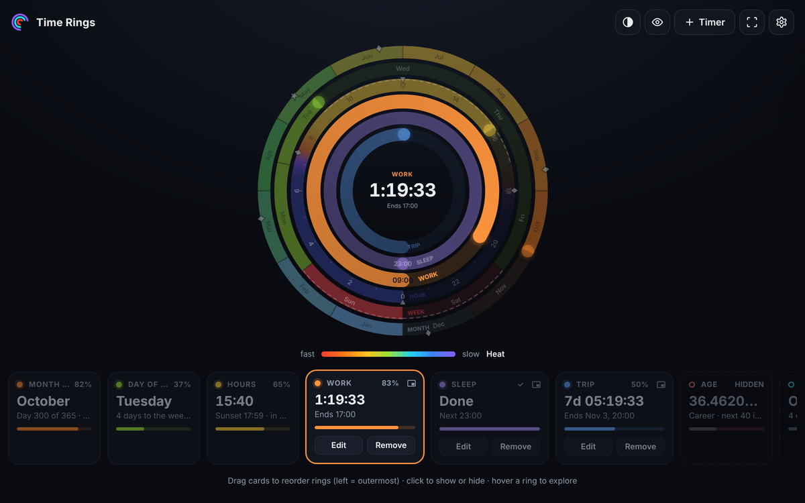

- **Every day:** a start time plus an end time (*Work 09:00–17:00*), or a start time plus a duration (*Gym 18:00, lasts 1 h 30 m*). Pick the weekdays it runs on. An end earlier than the start runs past midnight (*Sleep 22:00–06:00*).
- **Once:** a start date and time plus an end, or plus a duration in days, hours and minutes (*Trip, Oct 28 12:00 to Oct 30 12:00*).
- **How it fills:** a custom ring fills as its window passes, and the card shows the time left. Between windows, the card says when it starts next. A daily ring stays full for the rest of the day after it ends, then empties until its next start. A once ring stays full after it ends.
- There is no alarm at the end; use a timer for that. Custom rings don't count toward the six-timer limit.

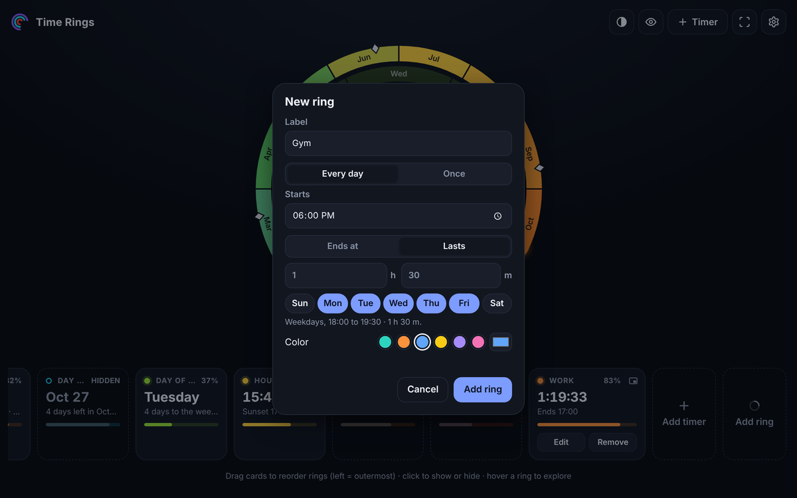

## Timers

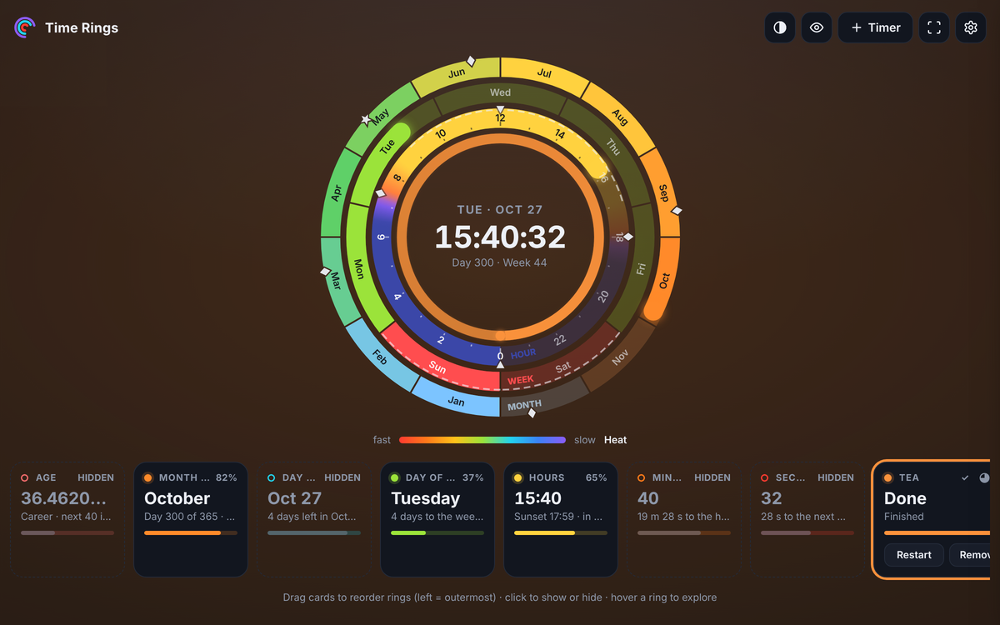

- Up to six timers, each with a label and a color, drawn as extra rings.
- Duration timers or "ends at" clock-time timers. Pause, reset and remove from the card.
- **Disc:** one timer at a time can be drawn as a disc filling the center of the dial instead of a ring. The colored wedge shrinks as time runs out, and the clock's second line shows its time left. The disc is translucent so the clock stays readable; in the **Rings only** minimal display it is solid and stands on its own. Hover it to see the timer's details. Making another timer the disc turns the previous one back into a ring.
- Timers survive page reloads and closing the tab. A timer that ended while the page was closed is shown as finished when you return.
- **When a timer ends:** a chime plays a few more times, and the whole page background breathes slowly in the timer's color (kept deliberately mild). **Click anywhere on the page to dismiss.** The dismissing click does not trigger anything else.
- Browsers block audio until you interact with the page once. If you have not clicked yet, the visual alarm still works.

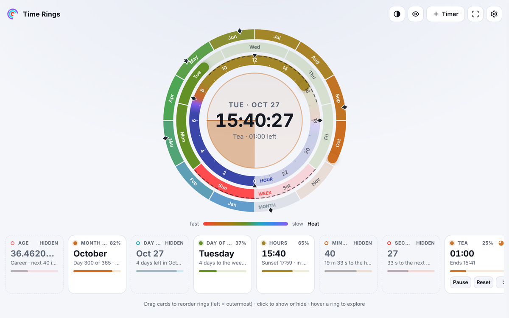

### Pop-out

The pop-out icon on a timer's card (custom rings have one too) opens the timer in a small window that stays on top of every other app and window, like picture-in-picture video.

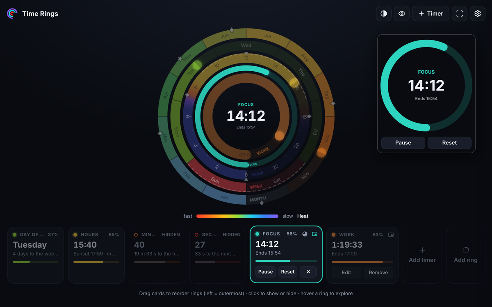

- It shows the timer big: its ring or disc, the time left and when it ends. Countdowns get **Pause/Resume** and **Reset** (**Restart** once finished) right in the window.
- It keeps time while the page is in the background, and the alarm still chimes. The first click in the pop-out after an alarm only silences it.
- One pop-out at a time: the icon on another card swaps what it shows. Click the pressed icon, or close the window, to end it.
- **Browser support:** Chrome and Edge 116+ use [Document Picture-in-Picture](https://developer.chrome.com/docs/web-platform/document-picture-in-picture), which gives the buttons. Safari gets a video picture-in-picture of the same face, without buttons. Firefox (desktop and Android) supports neither, so the icon is hidden there.
- The pop-out belongs to the tab that opened it. In the new-tab extension it closes if you navigate that tab to another site, so keep a Time Rings tab open for it.
- **On phones:** no phone browser supports Document Picture-in-Picture, so there are no buttons. Chrome for Android, Samsung Internet and Safari on iPhone do support video picture-in-picture, so the icon should appear there and float the timer face (not yet tested on real phones). **Firefox for Android has no picture-in-picture API for web pages, so the icon is hidden there**; use Chrome or Samsung Internet for the pop-out. Turning on "desktop site" changes the layout, not which APIs the browser has, so it doesn't help.

## Daily briefing

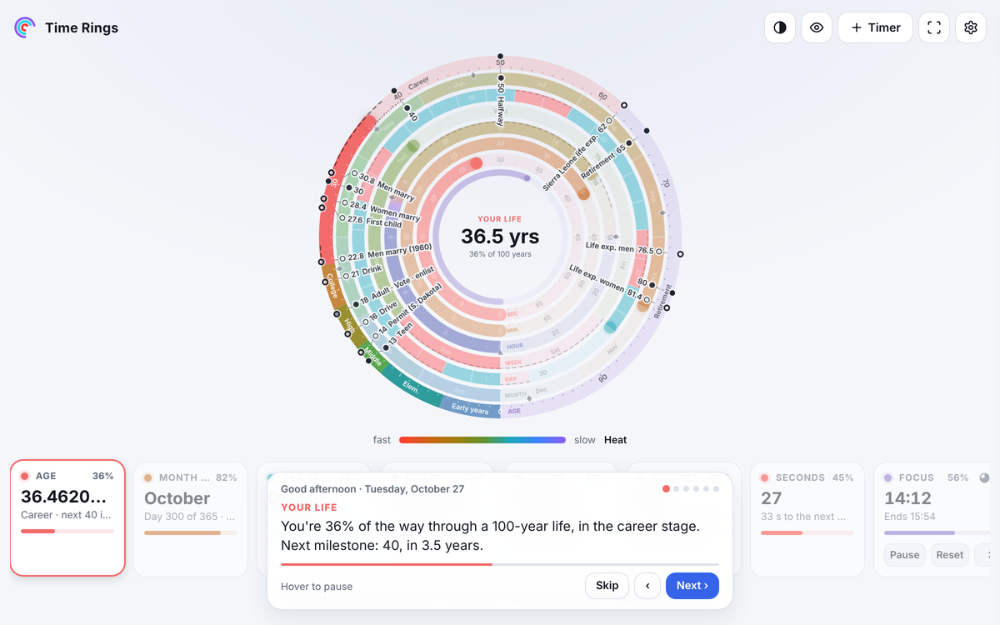

On the first new tab each day, the rings are presented one at a time, from the big picture to today:

1. **Your life:** percent of 100 years, current life stage, next milestone.
2. **This year:** days left, current season, next solstice or equinox.
3. **This month:** days left, weekend days remaining.
4. **This week:** how much is behind you, when the weekend starts.
5. **Today:** percent passed, daylight left, sunset time, end of the work day.
6. **Timers** that are running.

Only the rings you have turned on are included, and **minutes and seconds are never part of it**.

- **Pacing:** each step stays on screen for the time its caption takes to read at 238 words per minute, plus 20% and one second for looking at the ring. It is clamped to 3–10 seconds.
- **Controls:** **Skip**, **Next ›** and **‹** buttons. `Esc` skips; `←`/`→` navigate; hovering the caption pauses it. Clicking elsewhere ends the briefing and the click still goes through, so a bookmark opens right away.
- **Schedule:** once per calendar day, only when the tab is visible, so background tabs do not use it up.
- **Settings:** turn it off, or press **Play the briefing now**.

## Bookmarks

In the extension version, a shortcut strip under the dial can show:

- **Bookmarks bar**, including folders (nested menus) and live updates when you add or remove bookmarks.
- **Most visited** sites.
- **Off.**

Site icons come from Chrome's local favicon cache. `chrome://` links and `javascript:` bookmarklets are handled. The standalone HTML file hides this strip, because pages cannot read bookmarks.

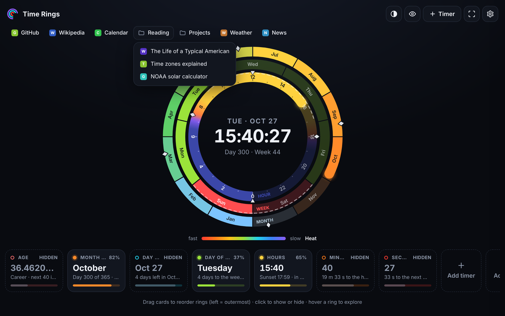

## Themes and accessibility

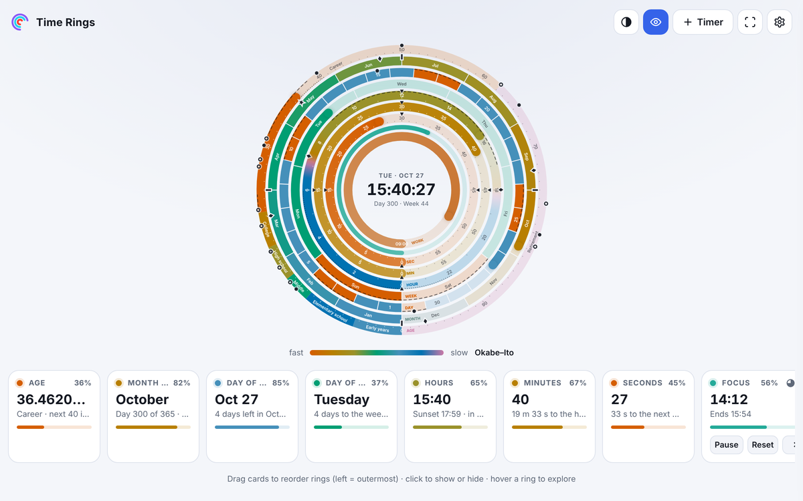

- **Theme:** auto (follows the system), light or dark.
- **Palettes:**
  - *Heat:* fast rings are hot (red, orange), slow rings are cold (blue, violet).
  - *Light spectrum:* fast is high-frequency violet, slow is low-frequency red.
  - *Viridis:* perceptually even, fast is yellow, slow is deep blue.
- **Color-blind mode:** the Okabe–Ito palette, ring names always visible, markers distinguished by shape and dash pattern.
- **Keyboard:** all cards are focusable buttons; `Enter`/`Space` toggle, `Alt`+arrows reorder.
- **Motion:** smooth animation can be turned off.
- **Mobile:** responsive layout with touch support. Tap a card to toggle, long-press to drag.

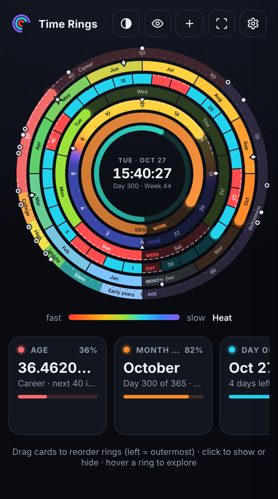

## Settings reference

| Setting | Default |
| --- | --- |
| Birthdate | empty |
| Milestones | `13 Teen, 18 Adult, 30, 40, 50 Halfway, 65 Retirement, 80` |
| Rings shown | Day of week, Hours, Month |
| Theme | Auto |
| Palette | Heat |
| Color-blind friendly | Off |
| Ring style | Arcs (a second style is available) |
| Zero point | Bottom |
| 12-hour clock | Off |
| Week starts on | Sunday |
| Seconds digits | Shown |
| Minimal display | Off (or Rings + clock, Rings only) |
| Shortcuts | Bookmarks bar |
| Meaning colors | On for week, day, hour, month, age |
| Daily briefing | On |

Everything is stored under a single `localStorage` key, `timeRings.v1`. Changes sync between open tabs.

## Privacy

- No analytics, no accounts, no network requests of its own.
- Settings, birthdate, timers and custom rings are stored only in your browser's `localStorage`.
- Location for sunrise and sunset is derived from your time zone, not from the browser's geolocation prompt.
- The extension reads bookmarks and top sites only to display them. Nothing leaves your device.

## How it works

- **Rendering:** a single `<canvas>` scaled for device pixel ratio, redrawn each animation frame. Rings animate with easing, and the briefing re-sweeps a ring's fill when it is spotlighted.
- **State:** one object `S` merged over defaults, saved with a debounce, flushed on `pagehide` and synced across tabs with the `storage` event.
- **Meaning colors:** painted as segment arrays, life-stage spans and a conic gradient for the hours sky.
- **Sun times:** the NOAA sunrise equation with a time-zone to coordinates table.
- **Layout:** the dial is sized from the available space with `ResizeObserver`, using `requestAnimationFrame` scheduling and a 2 px hysteresis to avoid resize feedback loops.
- **Reordering:** pointer events with a FLIP animation, a long-press for touch, and keyboard support.
- **Audio:** the alarm chime is synthesized with the Web Audio API, no audio files.
- **Extension:** `tools/build_ext.py` extracts the inline script into `app.js` (Manifest V3 forbids inline scripts), writes the manifest, generates icons and zips the result.

## Project layout

```
.
├── index.html            # the whole app: HTML, CSS and JS in one file
├── extension/            # generated Chrome MV3 new-tab extension
│   ├── manifest.json
│   ├── newtab.html
│   ├── app.js
│   └── icons/
├── tools/
│   ├── build_ext.py      # index.html -> extension/ + zip
│   ├── shots.cjs         # regenerates docs/screenshots/
│   ├── demo.cjs          # records the demo footage, then builds docs/demo.mp4 and docs/demo.gif
│   ├── demo_music.py     # the demo's background music (CC0), written to the same beat
│   └── demo-video/       # Remotion project that adds the captions; timeline.json sets the beat
├── docs/
│   ├── demo.mp4, demo.gif, demo-music.ogg
│   └── screenshots/
├── LICENSE
└── README.md
```

## Development

There is no build step for the web page: edit `index.html` and reload.

To regenerate the extension after editing (needs Python 3 and Pillow):

```bash
pip install pillow
python tools/build_ext.py index.html .
```

This rewrites `extension/` and creates `time-rings-newtab.zip`. Do not edit `extension/app.js` or `extension/newtab.html` by hand. They are overwritten on each build.

To regenerate the README screenshots and demo (needs Node, [Playwright](https://playwright.dev/) with its Chromium, Python 3 with Pillow and numpy, and ffmpeg):

```bash
node tools/shots.cjs           # every screenshot, or name some: node tools/shots.cjs pop-out mobile
node tools/demo.cjs            # docs/demo.mp4 (with music), docs/demo.gif, docs/demo-music.ogg
```

Both use fixed sample data (a fictional birthdate, sample timers, rings and bookmarks) and a fixed date and time, never your own settings, so reruns only differ where the app changed.

The demo is built in three parts that share one beat, [`tools/demo-video/timeline.json`](tools/demo-video/timeline.json), which holds the captions and the bar each one lands on:

1. `tools/demo.cjs` records the app with Playwright, acting on those bars. The 25-minute timer runs as a time-lapse.
2. `tools/demo_music.py` writes the music to the same bars, with a swell into every caption and the app's chime when the timer ends.
3. [Remotion](https://www.remotion.dev/) (in `tools/demo-video/`) lays the captions over the footage and the music.

To change a caption, edit `timeline.json` and rerun `node tools/demo.cjs`. To preview the composition, run `npm run studio` in `tools/demo-video/` after a first run. The first run installs Remotion there with `npm ci`, and Remotion downloads its own headless Chrome unless `REMOTION_BROWSER` points to one. Remotion has [its own license](https://www.remotion.dev/license): it is free for individuals and small teams.

Handy checks while developing:

- Open the browser console. There should be no errors.
- Test with real scrollbars and a resized window to check the layout logic.
- Set `lastBrief` in `localStorage` (`timeRings.v1`) to an old date to replay the daily briefing, or use **Play the briefing now** in settings.

## Known limitations

- Bookmarks and most-visited need the extension. A plain web page cannot read them.
- Browsers block audio until the first click, so the first alarm can be silent if you have not interacted with the page.
- Sunrise and sunset come from the time zone, so they are approximate (within minutes) for places far from the zone's reference city.
- The "typical American" life data are US averages and will not fit everyone.
- Chrome's extension Errors page can keep old entries after an update until you clear them.
- The pop-out window closes with the tab that opened it, and Firefox (desktop and Android) has no picture-in-picture API for it.

## Inspiration

- **Kurzgesagt's "Timeline of Your Life" poster.** Kurzgesagt's [Timeline of Your Life poster](https://shop-us.kurzgesagt.org/products/lifespan-timeline-poster) fits a whole lifespan onto one page. It is the idea behind the age ring (0-100), which makes the length of a life something you can see.
- **Visual timers.** I found out about visual timers from [Ruri Ohama's video on ADHD purchases](https://www.youtube.com/watch?v=SLTxcIhJgmI&t=1098s), which showed a [rainbow visual countdown timer](https://www.amazon.com/Yunbaoit-Protective-Rainbow-Countdown-Management/dp/B0CQMCW3R4). Seeing the time left as a shrinking colored area, rather than as digits, inspired the timer rings.
- **Circles all the way down.** The solar system and the Earth's motion are circular: the Earth spins once a day, the Moon circles the Earth, the Earth circles the Sun once a year. One night I realized a time visualizer should show the same thing, so it draws time as concentric rings and not as a line or a row of digits.

## License

[MIT](LICENSE) © 2026 Amin Taheri

The demo video's background music ([`docs/demo-music.ogg`](docs/demo-music.ogg)) is original. It is synthesized by [`tools/demo_music.py`](tools/demo_music.py) and dedicated to the public domain under [CC0 1.0](https://creativecommons.org/publicdomain/zero/1.0/).
